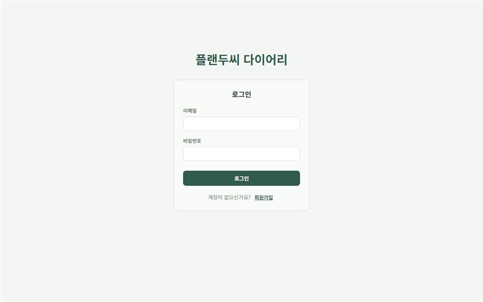
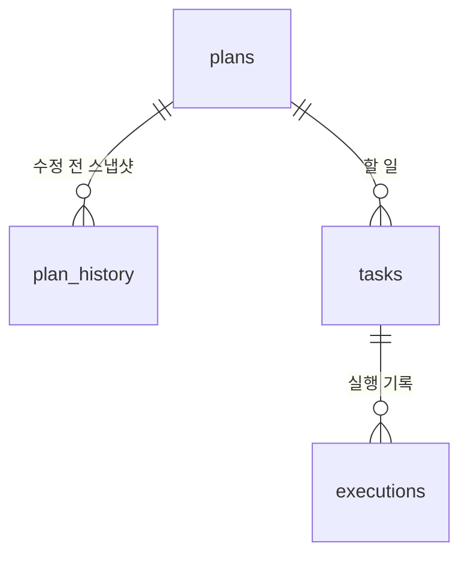

# pds-planner — 플랜두씨 다이어리

내 계획과 실제로 한 일을 나란히 놓고 돌아보는 풀스택 다이어리 앱. 계획 → 할 일 → 실행 기록 → 돌아보기를 한 흐름으로 묶었고, 로그인한 사용자마다 자기 데이터만 봅니다. (ALEPH 과정 과제 6 + 과제 7)

**[라이브 데모](https://pds-planner-frontend.vercel.app/)** (회원가입 후 사용. 서버가 무료 플랜이라 첫 접속에는 "서버를 깨우는 중" 화면이 잠시 나옵니다)



## 목차
[주요 기능](#주요-기능) · [기술 스택](#기술-스택) · [빠른 시작](#빠른-시작) · [구조와 데이터 모델](#구조와-데이터-모델) · [설계 결정과 배운 점](#설계-결정과-배운-점) · [한계와 다음 할 일](#한계와-다음-할-일) · [연락](#연락)

## 주요 기능
- **계획**: 제목, 기간, 우선순위, 성공 기준, 예상 시간을 적고 수정합니다. 수정 전 내용은 이력으로 남아 "이력 보기"에서 확인합니다. 계획 삭제도 됩니다.
- **할 일**: 생성·수정·삭제(소프트 삭제), 검색, 상태 필터, 정렬(우선순위 → 마감일 → ID, 기준은 화면에 표시).
- **기록**: 실제로 걸린 시간을 계산해 저장하고, 막힌 이유를 함께 적을 수 있습니다. 완료 버튼을 연타해도 중복 저장되지 않습니다.
- **돌아보기**: 전체·완료·지연·막힘 할 일 수와 예상/실제 시간을 집계하고, 숫자를 누르면 근거 기록 목록으로 내려갑니다(드릴다운). 다음 계획으로 넘길 고칠 점을 한 줄 남깁니다.
- **인증과 격리(과제 7)**: 회원가입·로그인·로그아웃, 모든 데이터 API에서 로그인 확인과 `user_id` 기준 접근 제어.
- 내 모든 데이터를 JSON으로 받는 API(`/api/export`)와 계정·자료 삭제 API가 있습니다.

## 기술 스택
- 프론트엔드: React 19 · Vite (Vercel)
- 백엔드: Node.js · Express 5 · `bcryptjs` · `express-session` + `express-mysql-session` (Render)
- 데이터베이스: MySQL 8 (배포는 Aiven 클라우드 MySQL)

## 빠른 시작
요구 사항: Node.js(프론트 빌드는 v24에서 확인), MySQL 8.

```bash
git clone https://github.com/ILB72/pds-planner.git
cd pds-planner

# 1) 데이터베이스: backend/schema.sql 실행 (아래 참고)
# 2) 백엔드
cd backend
npm install
cp .env.example .env        # DB 접속 값과 SESSION_SECRET을 채웁니다
node server.js              # http://localhost:3000

# 3) 프론트엔드 (새 터미널)
cd frontend
npm install
npm run dev                 # 개발 서버가 /api 를 localhost:3000 으로 넘깁니다
```

> [!NOTE]
> `backend/package.json`에는 `start` 스크립트가 없어 `node server.js`로 실행합니다. `.env`에는 `DB_HOST`, `DB_PORT`, `DB_USER`, `DB_PASSWORD`, `DB_NAME`, `PORT`(`.env.example` 참고)와 세션 서명용 `SESSION_SECRET`을 둡니다. 값은 저장소에 올리지 않습니다(`.gitignore`로 제외).

> [!WARNING]
> `backend/schema.sql`은 과제 6 시점의 4개 테이블만 담고 있습니다. 로그인용 `users` 테이블과 `plans`·`tasks`·`executions`의 `user_id` 컬럼은 배포 DB에 직접 적용했기 때문에 이 파일에 없습니다. 로컬에서 로그인까지 쓰려면 이 변경을 직접 추가해야 합니다.

프론트엔드는 `npm run build`로 빌드되는 것을 확인했습니다. 백엔드는 문법 검사까지만 했고, DB를 붙인 로컬 실행은 이번 정리에서 확인하지 못했습니다.

## 구조와 데이터 모델
```
pds-planner/
├── frontend/          React + Vite 앱 (src/App.jsx에 화면 전부)
├── backend/
│   ├── server.js      Express API (인증, 계획·할 일·기록, 집계)
│   ├── db.js          MySQL 연결 풀과 세션 저장소
│   ├── schema.sql     테이블 정의(과제 6 시점)
│   └── .env.example   환경 변수 이름(값 없음)
├── contracts/
│   └── pds-schema-v2.json   데이터 스키마와 날짜 규칙 정의
└── docs/images/       README용 스크린샷
```



- `executions.idempotency_key`에 `UNIQUE` 제약을 걸어 같은 기록의 중복 저장을 DB에서 막습니다.
- 날짜는 서울(KST) 기준으로 다룹니다. 완료되지 않았고 마감일이 서울 시간 기준 오늘보다 이전이면 "지연"입니다.

## 설계 결정과 배운 점
- **중복 방지는 두 겹으로.** 완료 버튼 연타를 버튼 비활성화(로딩 상태)만으로 믿지 않고 DB `UNIQUE` 제약까지 걸어 이중으로 막았습니다.
- **"지연"의 기준을 먼저 정했습니다.** 판정 기준이 헷갈려서 서울 시간으로 바꿔 "오늘보다 이전"만 지연으로 집계하도록 쿼리를 고쳤고, 오늘 마감인 할 일이 지연으로 잡히지 않도록 쿼리 수정을 직접 요청했습니다. 숫자는 근거를 볼 수 있게 전부 클릭 가능한 드릴다운으로 만들었습니다.
- **무료 서버의 절전 대응.** Render 무료 서버가 잠들어 첫 요청이 실패하는 문제를 로딩 화면과 3초 간격 재시도(`fetchWithRetry`)로 풀었습니다.
- **인증은 직접 구현.** 해싱과 세션 흐름을 이해하고 설명할 수 있도록 라이브러리·서비스 대신 `bcryptjs` + 세션 쿠키로 만들었습니다. JWT는 로그아웃 시 서버에서 즉시 무효화하기 어렵다는 이유로 쓰지 않았습니다.
- **배포에서 연달아 막힌 세 가지.** Render 빌드가 `bcrypt` 네이티브 모듈 컴파일 실패(`MODULE_NOT_FOUND`)로 멈춰 순수 JS인 `bcryptjs`로 바꿨고, CORS 403과 401은 `trust proxy` 설정과 Vercel 주소를 CORS `origin`에 명시해 해결했습니다.
- **기존 데이터를 지키며 사용자 격리.** 과제 6에서 쌓은 데이터를 잃지 않으려고 임시 계정 1개를 만들어 기존 행의 `user_id`로 연결하는 마이그레이션을 직접 설계했습니다.
- **AI가 제안한 디자인은 받아들이지 않았습니다.** 다크 우드 테마는 시선이 분산되고 읽기 어렵다고 판단해 밝고 차분한 "포레스트 세이지" 색으로 정했습니다.

## 한계와 다음 할 일
- 무료 서버 특성상 한동안 접속이 없으면 첫 화면이 느립니다.
- 학습용 구현이라 비밀번호 규칙, 로그인 시도 제한 같은 운영 수준의 보안 장치는 넣지 않았습니다.
- 자동화 테스트가 없습니다(`npm test`는 자리표시자).
- 프론트엔드의 `frontend/README.md`는 Vite 템플릿 기본 문서 그대로입니다.
- [ ] 인증용 테이블 변경을 `schema.sql`에 반영
- [ ] 백엔드 `start` 스크립트와 테스트 추가

## 연락
canzone0@daum.net
